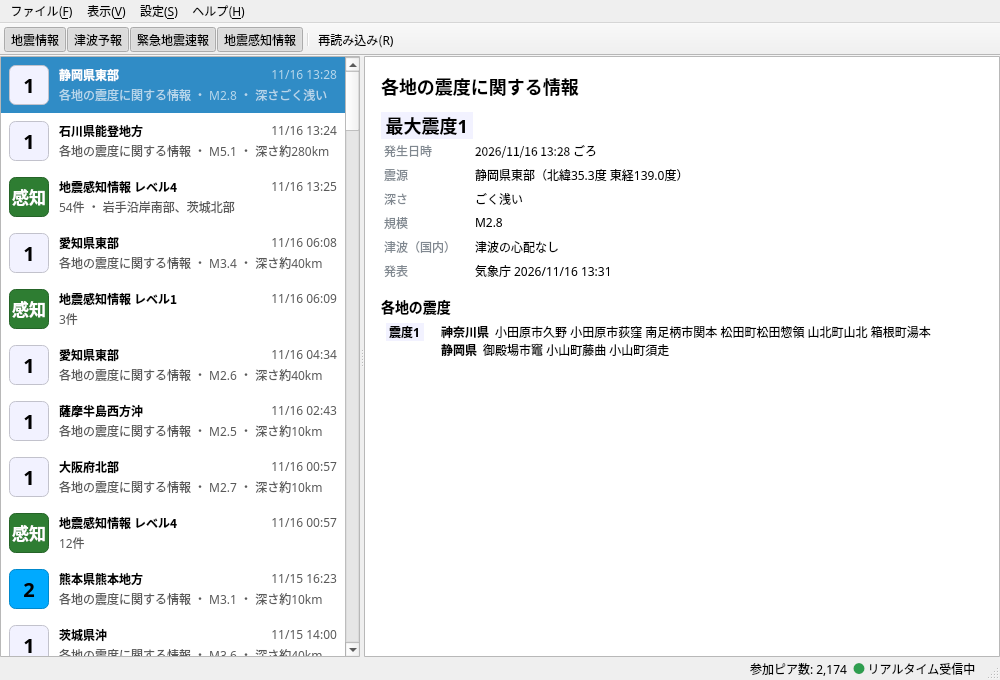

# p2pquake-qt

[P2P地震情報](https://www.p2pquake.net/) の [JSON API v2 / WebSocket API](https://www.p2pquake.net/develop/json_api_v2/) を使った、Linux 向けの非公式デスクトップクライアントです。C++20 と Qt 6 (Widgets / Network / WebSockets) で書かれています。



## できること

- 起動時に `/history` で直近の情報を取得し、`/ws` (WebSocket) でリアルタイムに受信
- 表示する情報
  - 地震情報 (551): 震度速報、震源、各地の震度、津波の有無
  - 津波予報 (552): 予報区ごとの種類・予想高さ・到達予想
  - 緊急地震速報 発表検出 (554) / 緊急地震速報（警報） (556)
  - 地震感知情報の解析結果 (9611): 同じ地震の更新は 1 行にまとめて表示
  - 参加ピア数 (555): ステータスバーに表示
- 種類ごとの絞り込み
- システムトレイへの常駐とデスクトップ通知 (通知する最小震度を選択可能)
- 切断時の自動再接続 (2 秒〜最大 60 秒の間隔)。再接続後は履歴を取り直して欠落を補う
- 動作確認用のサンドボックス接続 (設定メニュー)

## ビルド

必要なもの: CMake 3.21 以上、C++20 コンパイラ、Qt 6.5 以上 (Base, WebSockets)。

```bash
cmake -S . -B build -G Ninja
cmake --build build
./build/p2pquake-qt
```

インストールする場合 (実行ファイル、`.desktop`、アイコン):

```bash
sudo cmake --install build --prefix /usr/local
```

## テスト

```bash
ctest --test-dir build --output-on-failure
```

`tests/fixtures/` は実際の API のレスポンスを保存したものです。
`build/tests/render_window` は画面なしでウィンドウを PNG に描画する開発用ツールです (使い方は `tests/CMakeLists.txt` のコメント参照)。

通信の様子は次のようにして確認できます。

```bash
QT_FORCE_STDERR_LOGGING=1 QT_LOGGING_RULES="p2pquake.client.debug=true" ./build/p2pquake-qt
```

## 構成

| パス | 内容 |
| --- | --- |
| `src/core/Types.h` | API のデータ型 |
| `src/core/Parser.*` | JSON の解析 |
| `src/core/Client.*` | `/history` の取得と WebSocket 接続・再接続 |
| `src/core/Labels.*`, `AreaTable.*` | 震度・津波などの表示文字列、地域コード表 |
| `src/ui/Presenter.*` | 一覧・詳細・通知の表示内容の生成 |
| `src/ui/EventListModel.*`, `EventDelegate.*` | 一覧のモデルと描画 |
| `src/ui/MainWindow.*` | メインウィンドウ、トレイ、設定 |

## 注意

- API の利用制限: `/history` は 60 リクエスト/分、`/ws` は 1 つの IP アドレスにつき 2 接続までです。このため多重起動はできないようにしています。
- 仕様書では情報の ID は `id` ですが、WebSocket API は `_id` で配信してきます (2026 年 11 月時点)。どちらも受け付けます。
- 配信には遅延や欠落があり得ます。緊急地震速報を含め、身を守るための情報源としては使用しないでください。
- 情報提供: P2P地震情報、気象庁。二次利用の条件は <https://www.p2pquake.net/secondary_use/> を確認してください。
- `resources/epsp-area.csv` は [p2pquake/epsp-specifications](https://github.com/p2pquake/epsp-specifications) の地域コード表です (MIT License, Copyright (c) 2018 takuya (P2PQuake))。

## ライセンス

[MIT License](LICENSE) です。同梱している第三者の著作物については [THIRD_PARTY_NOTICES.md](THIRD_PARTY_NOTICES.md) を参照してください。
